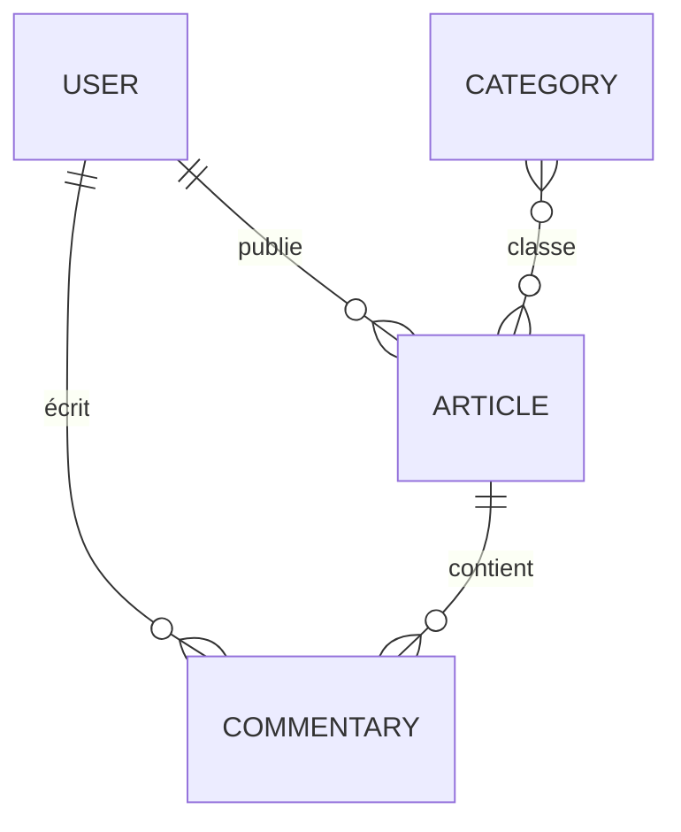

# Cahier des charges — Gardiennage des plantes

> Version 1.0 · 26/10/2026
> Légende des états : ✅ fait · 🟡 partiel · ⬜ à faire · ⚠️ non conforme

---

## 1. Contexte et objectifs

Plateforme web gratuite d'annonces entre voisins autour des plantes et des fleurs.

| Objectif | Indicateur |
|---|---|
| Donner une seconde vie aux plantes (moins de gaspillage) | Nombre d'annonces « Don » terminées |
| Faire garder ses plantes pendant une absence | Nombre de demandes ayant reçu une réponse |
| Créer du lien social local | Nombre de commentaires par annonce |

**Hors périmètre V1** : paiement (le service est gratuit), application mobile native, livraison, messagerie privée.

## 2. Utilisateurs et rôles

| Rôle | Peut |
|---|---|
| Visiteur | Consulter l'accueil, les annonces et les commentaires ; s'inscrire ; se connecter |
| Membre | + publier une annonce, commenter, modifier et supprimer **ses** annonces et **ses** commentaires, gérer son compte |
| Administrateur | + gérer les utilisateurs et les catégories, modérer toutes les annonces et tous les commentaires |

## 3. Exigences fonctionnelles

Priorités : **I** = indispensable · **Im** = important · **S** = souhaitable

| ID | Exigence | Priorité | État |
|---|---|---|---|
| F01 | Inscription : pseudo (3 à 10 caractères), e-mail, mot de passe (15 à 30 caractères) | I | ✅ |
| F02 | Connexion par e-mail et mot de passe (jeton JWT valable 12 h) | I | ✅ |
| F03 | Déconnexion | I | ✅ |
| F04 | Page d'accueil : présentation, 3 types d'annonce, dernières annonces, « Comment ça marche ? » | I | 🟡 annonces d'exemple, non reliées à l'API |
| F05 | Liste des annonces consultable sans compte | I | 🟡 sans photo, type ni ville |
| F06 | Détail d'une annonce avec ses commentaires | I | 🟡 |
| F07 | Publier une annonce : type, titre, description, ville, photo, catégories | I | 🟡 type, ville et photo absents |
| F08 | Modifier / supprimer une annonce (auteur ou admin uniquement) | I | ✅ |
| F09 | Commenter une annonce (membre connecté) | I | ✅ |
| F10 | Modifier / supprimer un commentaire (auteur ou admin uniquement) | Im | ✅ |
| F11 | Filtrer les annonces par type, catégorie et ville | Im | ⬜ |
| F12 | Rechercher par mot-clé | Im | ⬜ |
| F13 | Statut d'une annonce : disponible, réservée, terminée | Im | ⬜ |
| F14 | Espace membre : mes annonces, modifier mon profil, supprimer mon compte | Im | ⬜ |
| F15 | Administration : utilisateurs, catégories, modération | Im | 🟡 listes seules, tableau de bord vide |
| F16 | Distance approximative entre le membre et l'annonce | S | ⬜ |
| F17 | Signaler une annonce ou un commentaire | S | ⬜ |
| F18 | Notification par e-mail d'un nouveau commentaire | S | ⬜ |

## 4. Règles de gestion

| ID | Règle |
|---|---|
| RG01 | Tout est gratuit : aucune transaction financière sur le site. |
| RG02 | Une annonce a exactement un type : `don`, `demande` (de gardiennage) ou `offre` (de gardiennage). |
| RG03 | Une demande de gardiennage indique une date de début et une date de fin (fin ≥ début). |
| RG04 | Seuls l'auteur et un administrateur peuvent modifier ou supprimer une annonce ou un commentaire. |
| RG05 | Seul un administrateur gère les catégories et les comptes des autres utilisateurs. |
| RG06 | Le rôle administrateur ne peut jamais être choisi à l'inscription. |
| RG07 | La localisation publique se limite à la ville : jamais d'adresse exacte. |
| RG08 | Supprimer une annonce supprime ses commentaires. Supprimer un compte supprime ses annonces et ses commentaires. |
| RG09 | Une annonce « terminée » n'apparaît plus dans la liste par défaut. |
| RG10 | Longueurs maximales : titre 100 caractères, description 2000, commentaire 1000, nom de catégorie 30, pseudo 3 à 10, mot de passe 15 à 30. |
| RG11 | L'e-mail d'un membre n'est visible que par lui-même et par les administrateurs. |

## 5. Modèle de données (MongoDB)

> Dans le code, une annonce s'appelle `Article` et un commentaire `Commentary`.



| Collection | Champ | Type et contraintes | État |
|---|---|---|---|
| **User** | `username` | String, requis, 3 à 10 caractères | ✅ |
| | `email` | String, requis, **unique en base** | ✅ |
| | `password` | String, requis, hash bcrypt (coût 10), jamais renvoyé par l'API | ✅ |
| | `isAdmin` | Boolean, défaut `false` | ✅ |
| **Article** | `type` | Enum `don` · `demande` · `offre`, requis | ⬜ |
| | `title` · `content` | String, requis | ✅ |
| | `city` | String, requis | ⬜ |
| | `image` | String (URL de la photo) | ⬜ |
| | `status` | Enum `disponible` · `reservee` · `terminee`, défaut `disponible` | ⬜ |
| | `startDate` · `endDate` | Date, requis si `type = demande` | ⬜ |
| | `categories` | [ObjectId → Category] | ✅ |
| | `author` | ObjectId → User | ✅ |
| **Commentary** | `content` · `author` · `article` | String requis · ObjectId → User · ObjectId → Article | ✅ |
| **Category** | `name` | String, requis, unique | ✅ |

Toutes les collections ont `createdAt` et `updatedAt` (`timestamps: true`).

## 6. API REST

Base : `http://localhost:3000` · Authentification : en-tête `Authorization: Bearer <jeton>`

| Méthode | Route | Accès | État |
|---|---|---|---|
| POST | `/users/register` | Public (rôle admin impossible) | ✅ |
| POST | `/users/login` | Public | ✅ |
| GET | `/users/all` | Admin | ✅ |
| GET | `/users/:id` | Membre (sans mot de passe) | ✅ |
| PUT | `/users/:id` | Le membre lui-même ou un admin ; `isAdmin` modifiable par un admin seulement | ✅ |
| DELETE | `/users/:id` | Le membre lui-même ou un admin | ✅ |
| POST | `/article/new` | Membre | ✅ |
| GET | `/article/all` · `/article/:id` | Public | ✅ |
| PUT · DELETE | `/article/:id` | Auteur ou admin | ✅ |
| POST | `/commentary/new/:article_id` | Membre | ✅ |
| GET | `/commentary/all` · `/commentary/:id` | Public | ✅ |
| PUT · DELETE | `/commentary/:id` | Auteur ou admin | ✅ |
| GET | `/category/all` · `/category/:id` | Public | ✅ |
| POST · PUT · DELETE | `/category/...` | Admin | ✅ |

**Codes HTTP attendus** : `200` succès · `201` création · `400` données invalides · `401` non authentifié ou identifiants incorrects · `403` droits insuffisants · `404` introuvable · `409` e-mail déjà utilisé · `413` requête trop volumineuse · `429` trop de tentatives de connexion · `500` erreur serveur (message générique, sans détail technique).

## 7. Exigences non fonctionnelles

| Domaine | Exigence |
|---|---|
| Sécurité | Mots de passe hachés (bcrypt) à la création **et** à la modification. Jeton signé avec un secret stocké dans `.env`. Validation Joi de toutes les entrées. Champs sensibles exclus des réponses (`select: false`). Limite de 5 tentatives de connexion par 15 min. En-têtes HTTP sécurisés (`helmet`). CORS limité au domaine du front. HTTPS en production. |
| Accessibilité | WCAG 2.1 niveau AA (RGAA 4.1) : contrastes ≥ 4,5:1, navigation au clavier, focus visible, texte alternatif sur les images, libellé sur chaque champ, `lang="fr"`. |
| Performance | Lighthouse ≥ 90 (Performance, Accessibilité, SEO). Images ≤ 200 Ko avec chargement différé. LCP < 2,5 s. |
| Responsive | *Mobile first*, de 360 px à 1440 px. |
| Compatibilité | Deux dernières versions de Chrome, Firefox, Safari et Edge, sur ordinateur et mobile. |
| RGPD | Données minimales (pseudo, e-mail, ville). Case d'acceptation des CGU à l'inscription. Mentions légales et politique de confidentialité. Suppression du compte par le membre (F14). Aucun traceur tiers. |
| SEO | Titre et méta-description par page, URL lisibles. |
| Qualité | ESLint sans erreur. Composants en PascalCase, services en camelCase. Variables d'environnement pour toutes les URL. |
| Charte | Respect de la [Charte graphique](Charte_graphique.md). |

## 8. Architecture technique

```
Navigateur ──► Front React (Vite, :5173) ──HTTP/JSON + JWT──► API Express (:3000) ──Mongoose──► MongoDB
```

| Couche | Technologies |
|---|---|
| Front | React 19 · React Router 7 · Vite 8 · Tailwind CSS 4 · Flowbite 4 · Axios · jwt-decode |
| Back | Node.js ≥ 20.19 · Express 5 · Mongoose 9 · Joi 18 · bcrypt 6 · jsonwebtoken 9 · cors · dotenv |
| Base de données | MongoDB (local ou MongoDB Atlas) |
| Sécurité | helmet · express-rate-limit |
| Tests | node:test · supertest · mongodb-memory-server · Vitest · Testing Library · cspell |
| Outils | Git / GitHub · ESLint · nodemon |
| Hébergement | À définir (front statique + API Node + MongoDB Atlas) |

## 9. Écarts constatés dans le code existant (audit du 26/10/2026)

| # | Priorité | Écart | Correction | État |
|---|---|---|---|---|
| 1 | P1 | Routes de modification et de suppression sans authentification (articles, commentaires, catégories, utilisateurs) | Middlewares `auth` et `admin`, contrôle auteur/admin (`utils/isAuthorOrAdmin.js`) | ✅ |
| 2 | P1 | `isAdmin` accepté à l'inscription et modifiable par le membre lui-même | Retiré de `userCreate` ; modifiable par un admin seulement | ✅ |
| 3 | P1 | Hash du mot de passe renvoyé par `/users/register`, `/users/all` et `/users/:id` | `select: false` + suppression du champ dans `toJSON` | ✅ |
| 4 | P1 | `PUT /users/:id` enregistrait le nouveau mot de passe **en clair** (`findByIdAndUpdate` contourne le hook `pre("save")`) | Mise à jour par `save()` | ✅ |
| 5 | P2 | Codes HTTP inversés ; le front déconnectait l'utilisateur sur une simple erreur de formulaire (`400`) | Validation → `400`, identifiants ou jeton → `401`, droits → `403` ; déconnexion sur `401` uniquement | ✅ |
| 6 | P2 | `caller.service.js` plantait si l'API était injoignable | `error.response?.status` + message « Serveur injoignable » | ✅ |
| 7 | P2 | Modèle `Article` sans `type`, `city`, `image`, `status` ni dates | Voir section 5 (lot 3) | ⬜ |
| 8 | P2 | Les réponses `500` exposaient l'objet d'erreur complet | Message générique (`utils/handleError.js`) | ✅ |
| 9 | P2 | Unicité de l'e-mail et du nom de catégorie non garantie en base | `unique: true` + code `409` | ✅ |
| 10 | P2 | Mise à jour d'une ressource inexistante : `404` sans `return`, puis plantage | `return` ajouté | ✅ |
| 11 | P2 | Commentaires orphelins après suppression d'une annonce ou d'un compte | Suppression en cascade (RG08) | ✅ |
| 12 | P2 | `OneUser` : requête envoyée en boucle infinie (`useEffect` sans dépendances) et `loaded(true)` au lieu de `setLoaded(true)` | Dépendance `[id]`, appel corrigé | ✅ |
| 13 | P2 | `NewArticle` : décocher une catégorie créait un tableau imbriqué (`[[...]]`) | Tableau à plat | ✅ |
| 14 | P2 | `categoryService.updateCategory` n'envoyait pas les données | Corps de requête ajouté | ✅ |
| 15 | P2 | `Erreur : {err}` faisait planter React (objet affiché) | Helper `_helpers/errorMessage.js` | ✅ |
| 16 | P3 | `class=` au lieu de `className`, `key` manquantes dans les listes, `useEffect` sans `[id]` | Corrigé | ✅ |
| 17 | P3 | `react-router-dom`, `axios` et `jwt-decode` installés dans l'API sans être utilisés | Désinstallés | ✅ |
| 18 | P3 | URL de l'API et origine CORS codées en dur | `VITE_API_URL` (front), `CORS_ORIGIN` (API) | ✅ |
| 19 | P3 | Fautes : « à bien été supprimé », « Êtes vous sur » | « a bien été supprimé », « Êtes-vous sûr » | ✅ |
| 20 | P3 | ESLint : `import React` inutilisé dans 33 fichiers (inutile depuis React 17) | Imports supprimés, 0 erreur | ✅ |

**Second audit (tests de sécurité et d'orthographe)**

| # | Priorité | Écart | Correction | État |
|---|---|---|---|---|
| 21 | P1 | Un admin rétrogradé ou un compte supprimé gardait ses droits pendant 12 h (rôle lu dans le jeton) | Le middleware `auth` relit l'utilisateur en base à chaque requête | ✅ |
| 22 | P1 | Aucune limite de tentatives de connexion (force brute) | `express-rate-limit` : 5 échecs par 15 min et par IP | ✅ |
| 23 | P2 | Un membre pouvait lire l'e-mail de tous les autres (`GET /users/:id`) | Pseudo seulement, sauf pour soi-même ou un admin (RG11) | ✅ |
| 24 | P2 | « Alice@test.fr » et « alice@test.fr » créaient deux comptes | E-mail en minuscules (`lowercase`, `trim`) | ✅ |
| 25 | P2 | JSON mal formé → page d'erreur Express avec trace technique ; requête trop lourde → `500` | Gestionnaire d'erreurs JSON : `400`, `413` ; route inconnue → `404` JSON | ✅ |
| 26 | P2 | En-têtes de sécurité absents, `X-Powered-By: Express` exposé | `helmet` | ✅ |
| 27 | P2 | Textes sans longueur maximale (stockage illimité) ; catégorie mal formée → `500` | Limites Joi (RG10), identifiants validés, `ValidationError` → `400` | ✅ |
| 28 | P2 | Messages d'erreur de validation en anglais (« "password" length must be… ») | Messages Joi en français (`validations/messages.js`) | ✅ |
| 29 | P2 | Front : jeton expiré considéré comme valide | `isLogged()` vérifie la date d'expiration | ✅ |
| 30 | P2 | Commentaires invisibles et impossibles à ajouter depuis l'interface | Liste des commentaires + « Laisser un commentaire » dans `OneArticle` | ✅ |
| 31 | P3 | API sans `SECRET_KEY` : démarrage silencieux puis `500` à la connexion ; port aléatoire sans `PORT` | Arrêt avec message clair ; port `3000` par défaut | ✅ |
| 32 | P3 | Après l'inscription, retour à l'accueil sans être connecté | Redirection vers la connexion ; règles affichées sur le formulaire | ✅ |
| 33 | P3 | Orthographe et vocabulaire : accent manquant sur « Écrit », « article » au lieu d'« annonce », « Email » et « Token » au lieu d'« e-mail » et « jeton », espaces simples avant `? ! :`, fonctions mal nommées (pluriels anglais fautifs) | Corrigés, vérifiés automatiquement (section 12) | ✅ |
| 34 | P3 | `nodemon` et `mrmongoo-cli` installés comme dépendances de production | À déplacer en `devDependencies` | ⬜ |

## 10. Planning par lots

| Lot | Contenu | État |
|---|---|---|
| 1. Socle | Authentification, opérations de base (créer, lire, modifier, supprimer), page d'accueil | ✅ |
| 2. Sécurité et tests | Écarts 1 à 33 (hors 7), tests automatisés (section 12) | ✅ |
| 3. Annonces complètes | F05 à F07, F11 à F13, envoi de photo, accueil relié à l'API | ⬜ |
| 4. Espace membre et administration | F14, F15 | ⬜ |
| 5. Mise en production | Hébergement, HTTPS, mentions légales, audit Lighthouse | ⬜ |

## 11. Critères de recette

- [ ] Toutes les exigences de priorité **I** sont ✅.
- [x] Aucun écart P1 restant.
- [x] Parcours complet validé : inscription → connexion → publication → commentaire → modification → suppression (tests d'intégration).
- [x] Un visiteur ou un autre membre reçoit `401` ou `403` en tentant de modifier ou de supprimer une ressource qui ne lui appartient pas (tests de sécurité).
- [ ] Lighthouse ≥ 90 sur l'accueil et la liste des annonces, sur mobile et sur ordinateur.
- [x] ESLint : 0 erreur.
- [x] `./tests.sh` : tout est vert.

## 12. Tests automatisés

Un seul script lance tout : `./tests.sh` (ou une catégorie : `./tests.sh securite`). Code de sortie `0` si tout passe.

| Catégorie | Fichiers | Tests | Ce qui est vérifié |
|---|---|---|---|
| Unitaires | `api/tests/unitaires.test.js` · `front/tests/front.test.jsx` | 29 + 18 | Validations Joi, contrôle auteur/admin, gestion des erreurs, dates relatives, code couleur, session |
| Intégration | `api/tests/integration.test.js` · `front/tests/front.test.jsx` | 32 + 25 | Parcours complets sur une base MongoDB en mémoire ; pages React (accueil, en-tête, gardes, détail d'annonce) |
| Sécurité | `api/tests/securite.test.js` · `front/tests/front.test.jsx` | 35 + 8 | Accès sans jeton, IDOR, élévation de privilèges, JWT falsifié / expiré / `alg: none`, injection NoSQL, XSS, hachage, fuites, en-têtes, force brute |
| Orthographe | `cspell.json` · `tests/orthographe.test.js` | 82 fichiers + 19 | Dictionnaire français et anglais ; espaces insécables, accents sur les majuscules, vocabulaire (« annonce », « e-mail », « jeton »), messages de l'API en français |
| Qualité | — | 2 étapes | ESLint sans erreur, compilation du front |

Les fonctions réutilisables sont dans `api/tests/outils.js` (base jetable, création de membres, d'annonces et de commentaires) et `front/tests/outils.js` (connexion simulée, nettoyage après chaque test).
